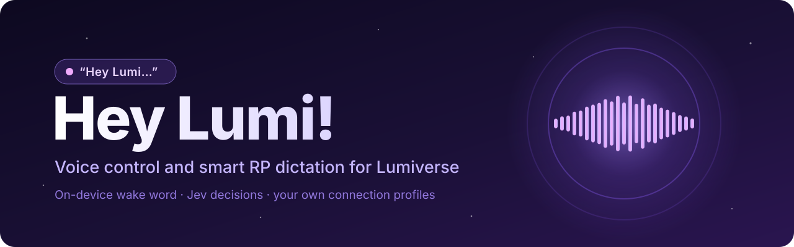
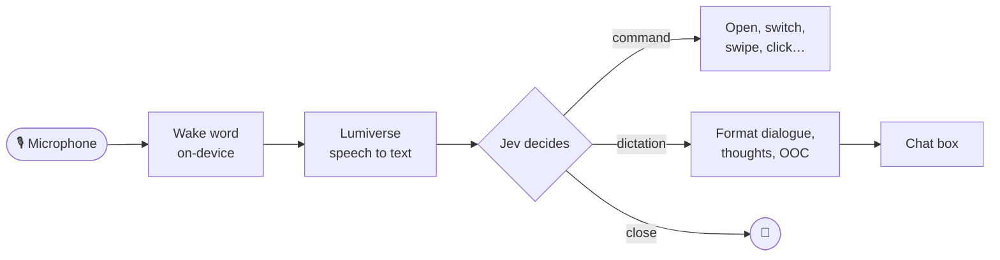

<p align="center">
  
</p>

<p align="center">
  <a href="https://github.com/japolino/hey-lumi/actions/workflows/ci.yml"></a>
  <a href="LICENSE"></a>
  <a href="https://github.com/prolix-oc/Lumiverse"></a>
  
  <a href="https://docs.typesafe.ai"></a>
  
</p>

<p align="center">
  <b>Voice control for <a href="https://github.com/prolix-oc/Lumiverse">Lumiverse</a>, plus smart dictation for roleplay.</b>
</p>

Say **"Hey Lumi"**, then tell Lumi what you want:

- 🎙️ **Commands:** "open my themes", "go to the lorebook", "open voice settings", "switch to Claude", "chat with Seo-yeon",
  "switch my persona to Mira", "regenerate that", "swipe left", "stop", "delete the last message" (Lumi asks first),
  "click the attach button" (anything visible on screen).
- ✍️ **Dictation:** just speak your message. Lumi keeps your words and formats them: dialogue in "quotes", thoughts in
  *italics*, OOC in ((double brackets)), and new paragraphs. Then say "send it", "rewrite it", "read it back", "clear it" or "undo".
- 👋 **Closing:** "that's all", "thanks Lumi", Escape, the × button, or a few seconds of silence. "Stop listening" turns the mic off.

A small **Lumi** pill sits in the corner: click it to start the microphone, click it again to talk without the wake word.
You can also type to Lumi in the bubble.

## ✨ How it works



Everything runs through your own Lumiverse connection profiles. Hey Lumi! has no models or keys of its own.

## 📦 Install

In Lumiverse: **Extensions → Install from GitHub** → `japolino/hey-lumi`. Enable it and grant the permissions.
The microphone needs **https or localhost**. On `http://<LAN IP>` the browser blocks it.

The first start downloads the on-device wake word detector (about 8 MB, once; checked by sha256 and cached in the
browser). Until it is ready, and in browsers without WebAssembly, Lumi recognises "Hey Lumi" with speech to text instead.

## 🔐 Permissions

| Permission | Why |
|---|---|
| `media` | Speech to text (Lumiverse STT) and text to speech |
| `decisions` | Jev decides what you meant (your Decision connection) |
| `generation` | Regenerate, continue, switch the LLM profile, rewrite, send |
| `chats`, `chat_mutation` | Delete or swipe messages, open chats |
| `characters`, `personas`, `presets` | Find them by name |
| `images` | Show character portraits to Jev ("the red-haired one") |
| `app_manipulation` | Apply a theme by voice (Lumiverse #476) and run commands that other extensions register |

Once Lumiverse #472 is merged, Hey Lumi! will also ask for `embeddings`. `main` does not request it yet, because current
Lumiverse refuses to enable an extension that asks for a permission it does not know. On a Lumiverse build that has #472
(for example the `hey-lumi-all` branch of japolino/Lumiverse), install or switch Hey Lumi! to its `hey-lumi-all` branch:
the same code, plus `embeddings` in `spindle.json`.

## ⚙️ Settings (the "Hey Lumi!" side panel)

- Start / stop listening, wake word on/off, close after N seconds of silence.
- Which connection profile to use for speech to text, Decision (Jev), LLM, embeddings and text to speech.
  "Lumiverse default" uses your default for that kind. Hey Lumi! has no model settings of its own.
  It works best with Jev 1.14 (`jev-preview`).
- Dictation format: thoughts in *italics* or plain, straight or curly quotes, ((OOC)) or [OOC].
- A list of the Lumiverse features found on your server.

## 🧩 Lumiverse versions

Hey Lumi! works on current Lumiverse. Some features need these Lumiverse changes (open pull requests); it finds them on
its own, and until then it says what is missing:

| Lumiverse PR | Unlocks |
|---|---|
| #473 chat composer API | Dictation and "send it" through the composer (today: the text box directly, which also works) |
| #475 stop/swipe commands | "stop" and "swipe" through the host commands; settings pages in the voice command list |
| #476 entity actions | "start a new chat with …", "switch preset", "apply the Emerald theme" |
| #477 connections by kind | Picking STT and TTS profiles in the settings |
| #478 text to speech for extensions | "read it back", spoken replies, pausing while Lumiverse reads aloud |
| #474 STT options | Better spelling of "Lumi" and character names; pausing while the Lumiverse mic records |
| #472 embeddings for extensions | Finding commands by meaning with your embedding connection |

## 🛡️ Privacy

Audio stays in your browser until a speech burst goes to your Lumiverse speech-to-text (Whistle runs on the device).
The wake word detector runs on the device. Text goes to your own Decision/LLM connections.

## 🛠️ Development

```
bun install
bun test src
bun run build        # typecheck + dist/backend.js + dist/frontend.js
```
Design and reports: `spec/` (DESIGN.md, SPEC.md, v0-report.md, kws-wasm.md).

## 📄 License

MIT, see [LICENSE](LICENSE). The wake word files it downloads are separate; their sources and licenses are in
[hey-lumi-assets/NOTICE.md](https://github.com/japolino/hey-lumi-assets/blob/main/NOTICE.md).
